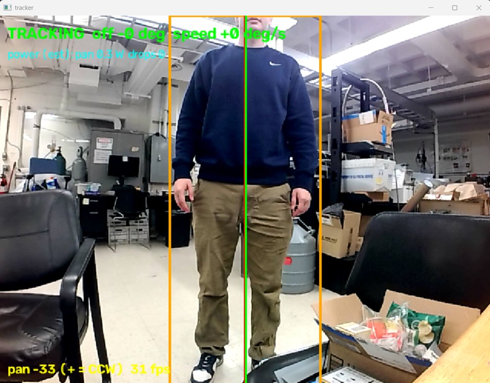
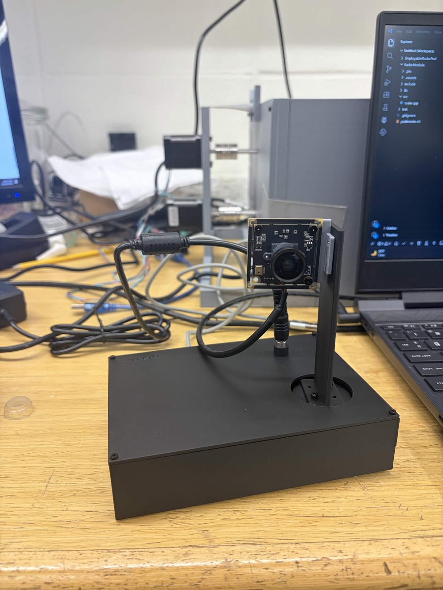
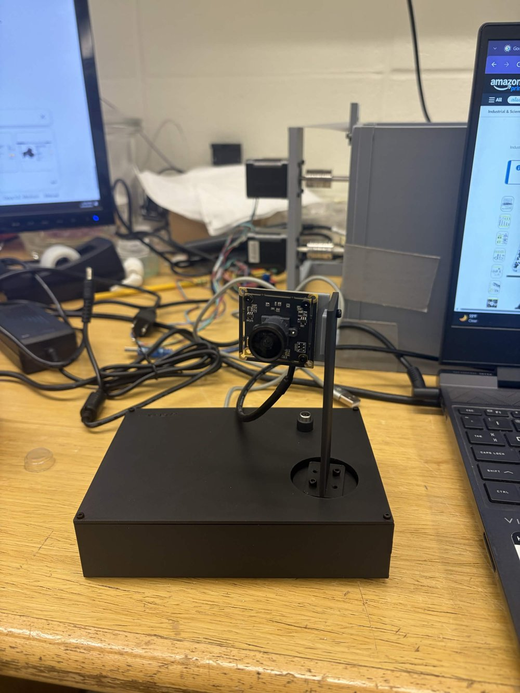
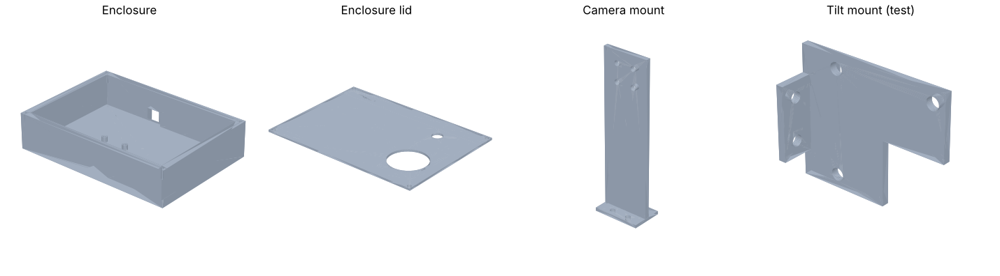

# Person-Tracking Camera Turret

A desktop turret that finds a person in its camera feed and swings to keep them centered. A PC runs YOLO person detection, and an ESP32 drives a brushless gimbal motor with smooth, rate-limited motion. The enclosure and mounts are custom designed in SolidWorks and 3D printed.

<p align="center">
  
</p>

<p align="center">
  
  
</p>

## What it does

- Detects people at **~30 fps** with YOLO11n on a 640×480 USB camera feed.
- Converts the target's pixel offset into a true **angle error** using the lens field of view (95°).
- Sends a **velocity command** to the ESP32 20–30 times a second. A proportional controller with smoothing and a deadband keeps the head steady instead of hunting.
- The ESP32 **ramps** smoothly to each commanded speed (acceleration-limited), so the head glides rather than jerks.
- **Fail-safes:** the motor stops if the PC goes quiet for 300 ms, the head holds still if the camera feed freezes or drops, and soft and hard pan limits keep the camera cable from being pulled.
- **Power management:** full drive voltage while moving and a low holding voltage when still, with live estimated motor power shown on screen.
- If the USB camera drops, it reconnects automatically, finding the camera by name even if Windows renumbers it.

## How it works

```
 USB camera ──► PC (tracker.py) ──USB serial──► ESP32 (main.cpp) ──3-phase PWM──► SimpleFOC driver ──► 2804 gimbal motor
               YOLO11n person detection          velocity ramp + limits                                  (pans the camera)
               angle error → speed command  ◄──  status: angle, power (20 Hz)
```

**Control loop (PC side):**
1. Detect people and pick the largest bounding box.
2. Angle error = `atan((cx − w/2)/(w/2) · tan(HFOV/2))`. This is the real angular offset, not a linear pixel guess.
3. Exponential smoothing (`SMOOTH = 0.5`) to remove detection jitter.
4. Speed = `−KP · error`, clamped to ±86°/s, zero inside a 2° deadband, zero past the pan limits.

**Motor side (ESP32):** SimpleFOC runs the 7-pole-pair gimbal motor in open-loop angle mode. The commanded velocity is integrated into a target angle with an acceleration limit of 6 rad/s², and the drive voltage switches between 4.5 V (moving) and 1.0 V (holding) to keep heat down.

### Serial protocol (115200 baud)

| Direction | Message | Meaning |
|---|---|---|
| PC → ESP32 | `V<rad/s>` | Pan velocity (sent continuously while tracking) |
| PC → ESP32 | `X<rad>` | Go to a pan angle (startup, re-centering, manual keys) |
| ESP32 → PC | `Ready` | Firmware booted |
| ESP32 → PC | `S <angle_rad> <power_W>` | Status, 20× per second |

## Hardware

| Part | Notes |
|---|---|
| ESP32 dev board | Motor control, serial link to the PC |
| 2804 brushless gimbal motor kit | Hollow shaft, 12 V, with SimpleFOC driver board (and AS5600 encoder, not used yet) |
| Arducam 5MP OV5648 USB camera | 95° wide-angle lens, UVC |
| 12 V 5 A power supply | 5.5×2.5 mm barrel jack |
| M2 / M2.5 socket-head screws | Enclosure and mounts |
| 3D-printed parts | Enclosure, lid, camera mount (see `cad/`) |

**Wiring:** driver phase inputs on ESP32 pins **32, 33, 18**, enable on **19**.

## Mechanical design

All parts were designed in SolidWorks. Printable STLs are in [`cad/stl`](cad/stl), and GitHub can preview them in 3D in the browser.

<p align="center"></p>

| File | Part |
|---|---|
| `Enclosure.stl` | Main body (154 × 110 × 34 mm), houses the electronics |
| `EnclosureLid.stl` | Top plate with the motor opening |
| `CameraMount.stl` | Upright arm holding the camera board |
| `CameraTiltMount_test.stl` | Prototype bracket for a future tilt axis |

## Repository layout

```
firmware/     ESP32 code (PlatformIO project)
software/     PC tracker (Python)
cad/stl/      Printable parts
cad/solidworks/  SolidWorks source + STEP exports
docs/images/  Photos and renders
```

## Running it

**Firmware:** open `firmware/` in VS Code with PlatformIO and upload. The SimpleFOC library installs automatically.

**Tracker (Windows):**
```bash
cd software
pip install -r requirements.txt
python tracker.py
```
Set `PORT` (e.g. `COM3`) at the top of `tracker.py`. On first run the YOLO weights download automatically, and the program asks you to confirm which direction is counter-clockwise. Click the video window, then use **a / d** to nudge, **c** to re-center and **q** to quit.

